<a id="top"></a>
<div align="center">

<!-- Matrix Digital Rain Animated Header Banner -->
<p align="center">
  
</p>

<!-- Live Animated Green Hacker Terminal Window -->
<p align="center">
  <a href="https://github.com/Madhukumar511">
    
  </a>
</p>

<!-- Unified Hacker Green Navigation Badges -->
<p align="center">
  <a href="https://github.com/Madhukumar511"></a>
  <a href="https://www.linkedin.com/in/madhukumar-v-a9953832b"></a>
  <a href="mailto:madhukumarv345@gmail.com"></a>
  
</p>

</div>

<p align="center">
  
</p>

### ⚡ About Me // System Profile & Directives

```yaml
Operator       : Madhukumar V
Academic Node  : Dept. of Artificial Intelligence & Machine Learning (AIML)
Institution    : Vidyavardhaka College of Engineering (VVCE), Mysuru
Coordinates    : Mysuru, Karnataka, India [12.3051° N, 76.6551° E]
Core Focus     : Low-Latency Green AI · Multispectral CV · Defensive AppSec · Quant Systems
Languages      : English (Fluent) · Kannada / ಕನ್ನಡ (Native) · Hindi / हिंदी (Working)
Philosophy     : "Zero redundant tokens. Physical Joules matter. Surgical code."
```

* 🎓 **Academic Base**: B.E. candidate in **Artificial Intelligence & Machine Learning (AIML)** at **Vidyavardhaka College of Engineering (VVCE)**, Mysuru. Specializing in high-performance neural compute, real-time inferencing pipelines, and distributed software systems.
* ⚡ **Green AI & Low-Latency Optimization**: Researching sub-5ms semantic vector caching ([Zerotrace AI](https://github.com/Madhukumar511/ZEROTRACE-AI)) to deliver zero-watt LLM inference loops. Profiling physical Joules directly at the hardware layer via Intel RAPL & NVIDIA NVML.
* 🛰️ **Planetary Satellite CV & Remote Sensing**: Building automated marine anomaly detection pipelines ([AquaIntel](https://github.com/Madhukumar511/AquaIntel)) using **ASTER L1T 8-band multispectral imagery** (VNIR + SWIR + TIR) integrated with Google Earth Engine API and FastAPI.
* 🛡️ **Cybersecurity & Defensive AppSec**: Conducting threat reconnaissance, vulnerability assessments, and defensive hardening across network perimeters, API interfaces, and cryptographic primitives.
* 📈 **Quant Systems & Predictive Modeling**: Engineering algorithmic market forecasting models ([MarketXpert](https://github.com/Madhukumar511/MarketXpert)) with bidirectional LSTM and ARIMA time-series analysis, while studying decentralized peer-to-peer consensus mechanisms.
* 🌐 **Surgical Development Philosophy**: Eliminating unnecessary dependencies, favoring native standard libraries, and writing minimal, high-throughput code designed for production environments.

<p align="center">
  
</p>

### 🎯 Active Learning & Research Trajectories

<!-- Animated Cybernetic Circuit Board Visual -->
<p align="center">
  
</p>

<table width="100%">
  <tr>
    <td width="50%" valign="top">
      <h4>🧠 01 // Machine Learning &amp; AI</h4>
      <p>Deep neural architectures, transformer mechanics, low-latency semantic caching, and multi-modal computer vision.</p>
      <code>PyTorch</code> &bull; <code>TensorFlow</code> &bull; <code>Ollama</code> &bull; <code>HuggingFace</code>
    </td>
    <td width="50%" valign="top">
      <h4>🛡️ 02 // Cybersecurity &amp; Defense</h4>
      <p>Web application security (AppSec), network packet inspection, defensive hardening, and cryptographic primitives.</p>
      <code>Network Security</code> &bull; <code>AppSec</code> &bull; <code>Cryptography</code> &bull; <code>Hardening</code>
    </td>
  </tr>
  <tr>
    <td width="50%" valign="top">
      <h4>📈 03 // Stock Markets &amp; Quant Trading</h4>
      <p>Time-series forecasting (LSTM, ARIMA), momentum indicators, market microstructure, and quantitative backtesting.</p>
      <code>LSTM</code> &bull; <code>Pandas</code> &bull; <code>Scikit-Learn</code> &bull; <code>yfinance</code>
    </td>
    <td width="50%" valign="top">
      <h4>⛓️ 04 // Crypto &amp; Web3 Ecosystems</h4>
      <p>Decentralized P2P networking, distributed consensus algorithms, cryptographic proofs, and smart contracts.</p>
      <code>Blockchain</code> &bull; <code>Distributed Systems</code> &bull; <code>P2P</code> &bull; <code>Smart Contracts</code>
    </td>
  </tr>
</table>

<p align="center">
  
</p>

### 🚀 Selected Systems & Built Prototypes

<table>
  <tr>
    <td width="50%" valign="top">
      <h3>⚡ <a href="https://github.com/Madhukumar511/ZEROTRACE-AI">Zerotrace AI</a></h3>
      <p><strong>Green AI Inference Gateway &amp; Telemetry</strong></p>
      <p>Inference proxy for LLMs applying 384-D vector caching for <strong>&lt;5ms zero-watt responses</strong> and token compression (~65% cut), profiling real physical Joules via RAPL &amp; NVML.</p>
      <p>
        
        
        
      </p>
    </td>
    <td width="50%" valign="top">
      <h3>🛰️ <a href="https://github.com/Madhukumar511/AquaIntel">AquaIntel</a></h3>
      <p><strong>Satellite Marine Debris &amp; Water Quality AI</strong></p>
      <p>Remote sensing platform analyzing <strong>ASTER L1T 8-band multispectral imagery</strong> via Google Earth Engine API to detect marine plastic waste and algal blooms.</p>
      <p>
        
        
        
      </p>
    </td>
  </tr>
  <tr>
    <td width="50%" valign="top">
      <h3>🛒 <a href="https://github.com/Madhukumar511/SmartCounterPro">SmartCounter Pro</a></h3>
      <p><strong>Autonomous Checkout &amp; Anti-Theft Scale</strong></p>
      <p>Retail checkout station with a 24-bit strain-gauge load cell, dynamic weight tolerance math, Three.js 3D digital twin, and Android Jetpack Compose scanner.</p>
      <p>
        
        
        
      </p>
    </td>
    <td width="50%" valign="top">
      <h3>📈 <a href="https://github.com/Madhukumar511/MarketXpert">MarketXpert</a></h3>
      <p><strong>Quantitative Stock Analytics &amp; Forecasting</strong></p>
      <p>Quantitative equity analytics suite for NSE/BSE equities featuring LSTM &amp; ARIMA time-series models, technical momentum indicators, and backtesting.</p>
      <p>
        
        
        
      </p>
    </td>
  </tr>
</table>

<p align="center">
  
</p>

### 🛠️ Tech Arsenal

<!-- Animated 3D Orbiting Tech Universe -->
<p align="center">
  
</p>

<div align="center">
  
  <br />
  
  <br />
  
</div>

<p align="center">
  
</p>

### 📊 Telemetry & Activity Stream

<!-- Animated Contribution Snake -->
<p align="center">
  <picture>
    <source media="(prefers-color-scheme: dark)" srcset="https://raw.githubusercontent.com/Madhukumar511/Madhukumar511/output/github-contribution-grid-snake-dark.svg" />
    <source media="(prefers-color-scheme: light)" srcset="https://raw.githubusercontent.com/Madhukumar511/Madhukumar511/output/github-contribution-grid-snake.svg" />
    
  </picture>
</p>

<!-- Matrix Telemetry Deck: Side-by-Side Streak & Custom Cyber HUD -->
<table width="100%">
  <tr>
    <td width="50%" align="center" valign="middle">
      <a href="https://github.com/Madhukumar511">
        
      </a>
    </td>
    <td width="50%" align="center" valign="middle">
      
    </td>
  </tr>
</table>

<!-- Matrix Activity Frequency Graph -->
<p align="center">
  <a href="https://github.com/Madhukumar511">
    
  </a>
</p>

<p align="center">
  
</p>

### 📡 Neural Dispatch // System Uplink

<!-- Animated Cyberpunk Spectrum & Radar Uplink Terminal -->
<p align="center">
  
</p>

<!-- Interactive Secure Communication Channels -->
<p align="center">
  <a href="https://www.linkedin.com/in/madhukumar-v-a9953832b">
    
  </a>
  &nbsp;&nbsp;
  <a href="mailto:madhukumarv345@gmail.com">
    
  </a>
  &nbsp;&nbsp;
  <a href="https://github.com/Madhukumar511?tab=repositories">
    
  </a>
</p>

<!-- Live CLI Terminal Card -->
<div align="center">
  <sub>⚡ <strong>Execute in your local shell to inspect live terminal credentials &amp; contact nodes:</strong></sub>
  <br /><br />
</div>

```bash
curl -sL https://raw.githubusercontent.com/Madhukumar511/Madhukumar511/main/card.sh | bash
```

<p align="center">
  
</p>

<div align="center">
  <sub>⚡ Engineered with Surgical Precision &bull; Madhukumar V &bull; AIML @ VVCE Mysuru ⚡</sub>
</div>
