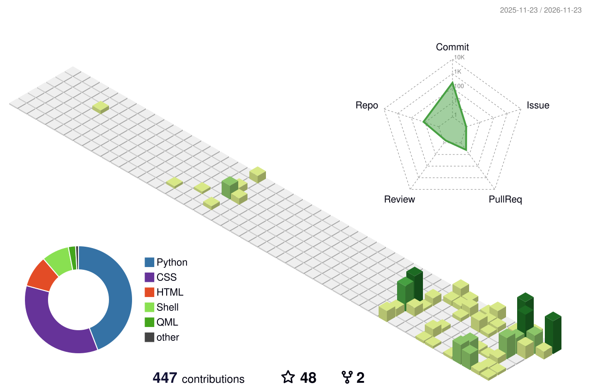

<div align="center">

<!-- Animated Header Wave Banner -->


<!-- Dynamic Animated Typing Text -->
<a href="https://github.com/Madhukumar511">
  
</a>

<p>
  <strong>Architecting energy-efficient AI inference gateways, satellite vision systems, IoT edge hardware, and bespoke Linux workflows.</strong>
</p>

<!-- Social & Profile Badges -->
<p>
  <a href="https://github.com/Madhukumar511"></a>
  <a href="https://linkedin.com/in/madhukumar-v"></a>
  <a href="mailto:madhukumarv345@gmail.com"></a>
  <a href="https://pixel-hut.vercel.app"></a>
</p>

<!-- Live Profile Counters & Status Badges -->
<p>
  
  
  
  
</p>

</div>

---

### ⚡ Developer Specification & Architecture

```python
from dataclasses import dataclass

@dataclass
class SystemsEngineer:
    name: str = "Madhukumar V"
    origin: str = "Mysuru, Karnataka, India"
    alma_mater: str = "Vidyavardhaka College of Engineering (VVCE)"
    department: str = "Computer Science & Engineering"
    
    # Core Engineering Verticals
    specializations: tuple = (
        "Green AI & Sub-5ms Vector Caching",
        "Physical Hardware Telemetry (Intel RAPL / NVIDIA NVML)",
        "Multispectral Planetary Remote Sensing (ASTER L1T / GEE)",
        "Embedded Strain-Gauge Weight Telemetry (SIH Finalist)",
        "Native Linux Desktop Ecosystems (Hyprland / C++ Qt Quick)",
    )
    
    # Operating Mantra
    mantra: str = "Cut synthetic bloat. Measure physical physics. Ship precision code."

    def get_flagship_stack(self) -> dict:
        return {
            "inference": ["FastAPI", "PyTorch", "Ollama", "HuggingFace"],
            "remote_sensing": ["Google Earth Engine", "TensorFlow", "GDAL"],
            "edge_hardware": ["ESP32", "24-bit HX711 Load Cell", "Three.js 3D Twin"],
            "systems_desktop": ["C++", "Qt Quick / QML", "Hyprland", "Bash"],
        }
```

---

## 👨‍💻 About Me

I am a Computer Science engineer at **Vidyavardhaka College of Engineering (VVCE)** in Mysuru, specializing in the intersection of high-throughput software architectures, physical hardware telemetry, and applied artificial intelligence.

Rather than treating compute as an infinite resource, I focus on engineering systems that eliminate unnecessary overhead: intercepting queries before they hit expensive GPU clusters, extracting ecological insights from satellite constellation bands, verifying retail transactions with real-time physical strain-gauge math, and handcrafting responsive Linux workstation environments.

* 🌿 **Green AI & Zero-Watt Inference**: Architecting gateways like **Zerotrace AI** that intercept LLM queries with 384-D semantic vector caching to deliver answers in `<5ms` at `0 Joules`, tracking real energy consumption across Intel RAPL (CPU) and NVIDIA NVML (GPU).
* 🛰️ **Planetary Remote Sensing**: Processing petabyte-scale multispectral satellite imagery from the **ASTER L1T** constellation via Google Earth Engine to detect marine microplastics, water clarity, and algal bloom dynamics.
* 🛒 **IoT Hardware & Anti-Theft Verification**: Designing autonomous checkout solutions powered by 24-bit strain-gauge load cells, dynamic noise-filtering tolerance math, Three.js 3D physics digital twins, and Jetpack Compose Android applications (**Smart India Hackathon**).
* 🐧 **Linux Craftsmanship**: Building custom anime aesthetic scenery rices, dynamic wallpaper palette extraction daemons, and C++/Qt Quick desktop hardware telemetry widgets for Omarchy Linux & Hyprland.
* 🗣️ **Spoken Languages**: English, Kannada (ಕನ್ನಡ), Hindi (हिंदी).
* 🎯 **Engineering Principles**: Surgical modifications, real physical measurement, standard library first, zero unearned abstractions.

---

## 🏛️ Core Engineering Verticals

<table width="100%">
  <tr>
    <td width="50%" valign="top">
      <h4>⚡ 01 / GREEN AI &amp; TELEMETRY</h4>
      <p>Building high-speed inference interceptors, 384-D vector cache layers, token-compression pipelines, and physical power profilers (Joules per token &amp; GPU wattage).</p>
    </td>
    <td width="50%" valign="top">
      <h4>🛰️ 02 / PLANETARY REMOTE SENSING</h4>
      <p>Autonomous marine debris detection, ocean clarity tracking, and multispectral band compositing with ASTER satellite observations and Google Earth Engine.</p>
    </td>
  </tr>
  <tr>
    <td width="50%" valign="top">
      <h4>🛒 03 / HARDWARE &amp; IOT VERIFICATION</h4>
      <p>Bridging physical strain-gauge sensors (ESP32 / HX711), real-time tolerance math, Three.js suspension digital twins, and mobile ML Kit barcode vision.</p>
    </td>
    <td width="50%" valign="top">
      <h4>🐧 04 / LINUX SYSTEMS &amp; RICING</h4>
      <p>Developing native Wayland compositor integrations, C++/QML system telemetry widgets, automated color-sync daemons, and aesthetic Hyprland workflows.</p>
    </td>
  </tr>
</table>

---

## 🚀 Featured Systems & Open-Source Projects

<table>
  <tr>
    <td width="50%" valign="top">
      <h3>⚡ <a href="https://github.com/Madhukumar511/ZEROTRACE-AI">Zerotrace AI</a></h3>
      <p><strong>Real-Time Hardware Telemetry &amp; Green AI Inference Gateway</strong></p>
      <p>An open-source inference proxy and semantic caching engine for Large Language Models. Intercepts incoming queries before heavy GPU clusters, applying 384-D semantic vector caching for <strong>&lt;5ms zero-watt responses</strong> and token compression (~65% reduction), while capturing true physical energy (RAPL Joules/token, NVML GPU wattage, and carbon emissions).</p>
      <p>
        
        
        
        
        
      </p>
    </td>
    <td width="50%" valign="top">
      <h3>🛰️ <a href="https://github.com/Madhukumar511/AquaIntel">AquaIntel</a></h3>
      <p><strong>Planetary Satellite Marine Debris &amp; Water Quality AI</strong></p>
      <p>A planetary-scale remote sensing and deep learning intelligence platform. Ingests multispectral satellite observations from the <strong>ASTER L1T constellation (8 spectral bands)</strong> via Google Earth Engine API to autonomously detect, classify, and track marine plastic waste, chlorophyll clarity, and harmful algal blooms.</p>
      <p>
        
        
        
        
        
      </p>
    </td>
  </tr>
  <tr>
    <td width="50%" valign="top">
      <h3>🛒 <a href="https://github.com/Madhukumar511/SmartCounterPro">SmartCounter Pro / Smart Cart</a></h3>
      <p><strong>Autonomous Supermarket Checkout &amp; IoT Anti-Theft Scale</strong></p>
      <p><strong>Smart India Hackathon Finalist System</strong> solving long checkout queues and retail shrinkage. Features a 24-bit strain gauge load cell with dynamic weight tolerance math (<code>Tolerance = max(15g, expected * 5%)</code>), an interactive Three.js 3D digital twin with spring physics suspension, and a native Jetpack Compose Android app with Google ML Kit.</p>
      <p>
        
        
        
        
        
      </p>
    </td>
    <td width="50%" valign="top">
      <h3>🎨 <a href="https://github.com/Madhukumar511/omarchy-shinsekai-theme">Omarchy Shinsekai Suite &amp; Sysmon</a></h3>
      <p><strong>Dynamic Linux Theming Daemon &amp; C++/QML Desktop Monitor</strong></p>
      <p>A complete anime aesthetic environment and systems tooling for Omarchy Linux &amp; Hyprland. Includes <code>omarchy-sysmon</code>, a real-time C++ &amp; Qt Quick/QML desktop system monitor widget, and a Python dynamic theming daemon that automatically extracts wallpaper color palettes and syncs Waybar, Rofi, Kitty, and Foot.</p>
      <p>
        
        
        
        
        
      </p>
    </td>
  </tr>
  <tr>
    <td width="50%" valign="top">
      <h3>📈 <a href="https://github.com/Madhukumar511/MarketXpert">MarketXpert</a></h3>
      <p><strong>Algorithmic Financial Analytics &amp; Quantitative Stock Modeling</strong></p>
      <p>A quantitative equity forecasting and technical analytics suite for NSE and BSE stock markets. Implements time-series predictive modeling (LSTM, ARIMA, Prophet), automated technical indicator calculators (RSI, MACD, Bollinger Bands, Moving Averages), and volatility backtesting engines.</p>
      <p>
        
        
        
        
      </p>
    </td>
    <td width="50%" valign="top">
      <h3>🌐 <a href="https://pixel-hut.vercel.app">Pixel-Hut &amp; Web Platforms</a></h3>
      <p><strong>Modern Cloud Web Platforms &amp; Community Applications</strong></p>
      <p>A suite of responsive web platforms including <a href="https://pixel-hut.vercel.app">Pixel-Hut</a> (creative community showcase), <a href="https://vvce-fitness-club.vercel.app">VVCE Fitness Club</a> (campus athletic portal), and <a href="https://campus-genie-orcin.vercel.app">CampusGenie</a>. Engineered with TypeScript, React, Next.js, and modern cloud deployment pipelines.</p>
      <p>
        <a href="https://pixel-hut.vercel.app"></a>
        
        
        
      </p>
    </td>
  </tr>
</table>

---

## 🛠️ Technical Matrix & Skills Arsenal

<div align="center">

### 💻 Languages & Core Runtime


### 🧠 AI, Deep Learning & Remote Sensing


### ⚙️ Systems, Cloud, Database & Tools


<br />

<p>
  
  
  
  
  
  
</p>

</div>

---

## 📊 Live Activity & Contributions

<div align="center">

### 🐍 Contribution Journey

<!-- Animated Contribution Snake Eating the Contribution Grid -->
<picture>
  <source media="(prefers-color-scheme: dark)" srcset="https://raw.githubusercontent.com/Madhukumar511/Madhukumar511/output/github-contribution-grid-snake-dark.svg" />
  <source media="(prefers-color-scheme: light)" srcset="https://raw.githubusercontent.com/Madhukumar511/Madhukumar511/output/github-contribution-grid-snake.svg" />
  
</picture>

<br /><br />

<!-- Streak Stats -->
<a href="https://github.com/Madhukumar511">
  
</a>

<br /><br />

<!-- Interactive Activity Graph -->
<a href="https://github.com/Madhukumar511">
  
</a>

<br /><br />

<!-- Dynamic Programming Quote -->


<br /><br />

<a href="https://github.com/Madhukumar511?tab=repositories">
  
</a>
<a href="https://github.com/Madhukumar511?tab=overview">
  
</a>

</div>

<br />

<details>
  <summary><strong>📐 3D Contribution Calendar &amp; Historical Visualizations</strong></summary>
  <br />

  <div align="center">
    <picture>
      <source media="(prefers-color-scheme: dark)" srcset="./profile-3d-contrib/profile-night-green.svg" />
      <source media="(prefers-color-scheme: light)" srcset="./profile-3d-contrib/profile-green.svg" />
      
    </picture>
    <p><sub>Automated nightly generation via GitHub Actions profile-3d-contrib workflow.</sub></p>
  </div>
</details>

---

## 🧭 Strategic Horizon & Research Focus

| 🔨 What I'm Building | 🔬 What I'm Researching | 🤝 Open For |
| :--- | :--- | :--- |
| **Green AI Inference Gateways** — Sub-5ms semantic cache hits with zero GPU wattage | **Edge AI Quantization** — Low-bit tensor kernels, KV-cache compression, and INT4 on consumer hardware | High-impact AI Systems &amp; Distributed Engineering roles |
| **Planetary Remote Sensing Systems** — Automated multispectral analysis &amp; environmental alerting | **Real-Time Spatial Vision** — Multi-camera tracking, stereo depth, and autonomous navigation | Smart India Hackathon &amp; national-level innovation projects |
| **Native Linux Utilities** — C++/Qt Quick desktop system monitors &amp; Wayland compositing tools | **Hardware-Software Verification** — High-precision ADC strain-gauge filtering &amp; anti-theft engines | Open-source collaborations on GitHub |

---

## 🗺️ Project Navigation

<details>
  <summary><strong>Click to expand comprehensive project index</strong></summary>
  <br />

  | Repository | Focus Area | Key Technologies | Status |
  | :--- | :--- | :--- | :--- |
  | [ZEROTRACE-AI](https://github.com/Madhukumar511/ZEROTRACE-AI) | Green AI Inference Gateway &amp; Telemetry | FastAPI, PyTorch, Ollama, NVML, RAPL | Active Open Source |
  | [AquaIntel](https://github.com/Madhukumar511/AquaIntel) | Planetary Satellite Marine Debris AI | TensorFlow, Google Earth Engine, FastAPI | Active Open Source |
  | [SmartCounterPro](https://github.com/Madhukumar511/SmartCounterPro) | Autonomous Supermarket Self-Checkout | Android, Kotlin, Jetpack Compose, ML Kit | Hackathon Finalist |
  | [omarchy-shinsekai-theme](https://github.com/Madhukumar511/omarchy-shinsekai-theme) | Anime Scenery Desktop Rice | Hyprland, Waybar, CSS, Dotfiles | Published Rice |
  | [omarchy-shinsekai-tools](https://github.com/Madhukumar511/omarchy-shinsekai-tools) | Dynamic Wallpaper Theming Daemon | Python, Bash, Palette Extraction | Tooling Suite |
  | [omarchy-sysmon](https://github.com/Madhukumar511/omarchy-sysmon) | Real-Time Hardware Telemetry Monitor | C++, Qt Quick, QML, Linux | Desktop Utility |
  | [MarketXpert](https://github.com/Madhukumar511/MarketXpert) | Quantitative Equity Analytics | Python, Streamlit, Scikit-learn, LSTM | Analytics Platform |
  | [Agentic-Helper](https://github.com/Madhukumar511/Agentic-Helper) | Task Automation &amp; Web Engine | Python, Headless Automation, Playwright | Automation Tool |
  | [Pixel-Hut](https://pixel-hut.vercel.app) | Responsive Web Platform | TypeScript, React, Next.js, Vercel | Production Web |
  | [vvce-fitness-club](https://vvce-fitness-club.vercel.app) | College Fitness &amp; Sports Portal | HTML5, Modern CSS, Responsive Web | Production Web |

</details>

---

## 📬 Let's Connect & Collaborate

<div align="center">

Whether you're developing **Green AI infrastructure, remote sensing vision pipelines, IoT edge devices, or high-performance Linux desktop tools**, I’m always open to discussing technical ideas and building transformative software.

<br />

<a href="mailto:madhukumarv345@gmail.com"></a>
<a href="https://linkedin.com/in/madhukumar-v"></a>
<a href="https://github.com/Madhukumar511"></a>

<br /><br />

<!-- Animated Footer Wave -->


<p><sub>⚡ Designed with high-performance craftsmanship &bull; Mysuru, Karnataka, India ⚡</sub></p>

</div>
